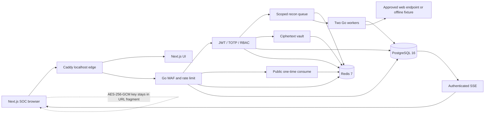

<div align="center">

# AEGIS
### Zero-trust security operations console

**Edge WAF · Identity · Scoped Recon · Ephemeral Vault**

Go 1.27 · Next.js 15 · PostgreSQL 16 · Redis 7.2 · Docker Compose

A local-first, open-source defensive engineering lab with a dark black, pink, yellow and white SOC interface.

</div>

> **Development reference implementation, not production-ready security infrastructure.** Do not expose this stack to the internet or enter real secrets. Full integration tests need to pass on a Docker-enabled machine. See [SECURITY.md](SECURITY.md).

## Architecture



- **Edge:** same-origin Caddy routes `/api/*` to Go. A Redis Lua sliding window enforces limits; signature blocks produce asynchronous, payload-free audit records. Security headers and body limits precede application handlers.
- **Identity:** Argon2id password hashing, short-lived HS256 JWTs, encrypted TOTP setup, fixed seven-day refresh families, atomic replay revocation and database-backed roles. Registration grants Viewer only. The configured bootstrap account starts as Admin. Access tokens are checked against Redis and current database roles on every protected request.
- **Recon:** analysts/admins submit approved DNS names. Postgres persists jobs and reports; Redis queues wake workers. Two bounded workers run DNS, HTTPS TLS and header checks and two web-port connectivity checks, pinning a vetted address. Browser receives authenticated SSE status updates; each job is owner-scoped.
- **Vault:** browser generates an independent AES-256-GCM key and 96-bit IV, encrypts a note, sends only ciphertext/IV/TTL and creates a fragment link. The recipient explicitly clicks Reveal; Redis GETDEL consumes the envelope once. Redis does not persist this data to disk by design.
- **DevSecOps:** container healthchecks, non-root app processes, loopback binding, generated credentials, unit tests, local integration tests, crypto tests, vulnerability scanning and Docker build validation.

## Repository layout

```text
Aegis/
├── .github/workflows/devsecops.yml
├── backend/
│   ├── main.go               # routing, persistence, password hashing, JWT, RBAC
│   ├── auth.go               # login, registration, refresh replay, TOTP
│   ├── edge.go               # WAF, Lua rate limits, audit worker
│   ├── scanner.go            # queue, scoped DNS/HTTPS worker, SSE
│   ├── vault.go              # encrypted envelope and atomic consume
│   ├── internal/security/    # pure validation and unit tests
│   ├── migrations/001_initial.sql
│   ├── go.mod
│   └── Dockerfile
├── frontend/
│   ├── app/page.tsx          # SOC console
│   ├── app/vault/page.tsx    # recipient reveal page
│   ├── app/globals.css       # theme / responsive layout
│   ├── components/          # API and browser cryptography
│   ├── tests/crypto.test.cjs
│   ├── middleware.ts         # nonce-based CSP
│   └── Dockerfile
├── scripts/
│   ├── setup.ps1             # random local credentials
│   ├── lock.ps1              # resolve dependency checksums/lockfile
│   └── attack_sim.py         # fixed localhost defensive tests
├── Caddyfile
├── docker-compose.yml
├── .env.example
├── SECURITY.md
├── CONTINUATION.md
└── LICENSE
```

## Quick start (Windows PowerShell)

Prerequisites: Docker Desktop (Linux containers, Compose v2), Git, a recent Chromium/Firefox browser, Python 3 for integration tests. GitHub CLI is optional. Internet access is needed to pull images and packages. Use Docker only if your machine is authorized to run it.

```powershell
Set-Location D:\Aegis
powershell -NoProfile -ExecutionPolicy Bypass -File .\scripts\setup.ps1
docker compose config --quiet
docker compose up --build -d
docker compose ps
curl.exe http://localhost:3000/health
```

Open **http://localhost:3000**. Use `ADMIN_EMAIL` and `ADMIN_PASSWORD` from `.env` (view locally using `Get-Content .env`; do not share or commit its contents). The first start bootstraps the administrator and runs SQL migrations. Keep `.env` with your local backup; changing the initial password in `.env` after database creation does not change the stored password. Never delete the persistent volume to recover data.

If your Docker network already uses `172.29.247.0/24`, choose an unused private subnet in Compose and change the gateway IP and `TRUSTED_PROXY_IP` together. If port 3000 is occupied, stop the other local service before launching Aegis; alternatively change the published port, origin, and local test URLs consistently.

### Verify and test

1. Sign in as bootstrap admin. In Recon, submit `demo.aegis.test`. This fixture is offline: watch status steps and inspect the clearly marked fictional DNS/TLS/HTTP report.
2. Open Vault, enter a harmless sample note, select 5 minutes and create the link. Copy it into a new private browser window, click Reveal and consume, and verify the sample matches. Open the original full link again and click Reveal; it must return unavailable. The fragment is removed from the address bar after it is parsed, so retain the original link for the second test.
3. Run the integration suite *before* enabling admin MFA. It tests WAF query/header/JSON filtering, local-only rate limiting, RBAC, report ownership, refresh replay, SSRF validation, SSE and simultaneous atomic vault consumption. It creates disposable Viewer accounts and demo reports in the database. If MFA is already enabled, supply a current unused code in `AEGIS_TEST_TOTP` for this run only.

```powershell
py -3 .\scripts\attack_sim.py
# Or, if Python was installed without the launcher:
# python .\scripts\attack_sim.py
```

The simulator accepts no remote URL, uses no external proxy, follows no redirects and only sends bounded test requests to the local Aegis API. Wait at least 65 seconds between repeated runs so rate windows expire. It is not a load test.

Optional: local Go/Node validation if installed, or run the same tests in GitHub Actions. Dependency lock files are generated from registries on a connected machine:

```powershell
powershell -NoProfile -ExecutionPolicy Bypass -File .\scripts\lock.ps1
Set-Location backend
go test -race ./...
go vet ./...
Set-Location ..\frontend
npm ci
npm run test:crypto
npm run typecheck
npm run build
Set-Location ..
```

### API endpoints

All request bodies are JSON; mutations are same-origin. Cookies are HttpOnly, Secure and SameSite=Strict. Local curl supports Secure cookies for `http://localhost`. Browser access to vault is restricted to a secure context (localhost or trusted HTTPS).

| Method | Path | Access |
|---|---|---|
| GET | `/health`, `/api/probe` | Public (probe limited) |
| POST | `/api/auth/register`, `/api/auth/login`, `/api/auth/refresh`, `/api/auth/logout` | Public / session cookies |
| GET | `/api/me` | Authenticated |
| POST | `/api/mfa/setup`, `/api/mfa/confirm` | Authenticated, password required |
| GET | `/api/scans`, `/api/scans/{id}`, `/api/scans/{id}/events` | Authenticated, own records only |
| POST | `/api/scans` | Analyst/Admin |
| GET | `/api/telemetry`, `/api/admin/users` | Admin |
| PUT | `/api/admin/users/{id}/role` | Admin, not self |
| POST | `/api/vault` | Authenticated |
| POST | `/api/vault/{id}/consume` | Public possession of random ID |

### Live recon scope

Default: only `demo.aegis.test`, no network traffic. The operator can configure exact, independently authorized hostnames in `RECON_ALLOWED_HOSTS` as a comma-separated list and restart the backend. The scanner rejects literal IPs, nonapproved hosts, non-public address answers, redirects and arbitrary URL paths; it never follows MX/NS names or user-provided ports. It checks only the first vetted address for web services, and does not infer a vulnerability from missing headers. Keep the default demo configuration for portfolio use. See the egress caveats in [SECURITY.md](SECURITY.md).

### Stopping and troubleshooting

```powershell
docker compose logs --tail=100 backend frontend gateway
docker compose down
# Later, restart with:
docker compose up -d
```

`docker compose down` preserves the Postgres named volume but removes Redis containers and ephemeral contents. Do not use `down -v` unless you explicitly want to erase the database. If a build fails, inspect logs; don't downgrade dependencies or disable security checks merely to get a green build. If a browser rejects cookies, use exactly `http://localhost:3000` (not a LAN IP) and a current browser.

## GitHub publishing

Run `scripts/lock.ps1` on an internet-connected machine first. Check `git status` and confirm `.env` is ignored; do not publish cookies, request JSON containing credentials, screenshots of secrets, or database volumes. Then:

```powershell
git init -b main
git add .
git diff --cached --stat
git check-ignore .env
git commit -m "feat: initial Aegis security engineering lab"
gh auth login
gh repo create Aegis --public --source=. --remote=origin --push
```

Or create a new empty repository on GitHub and set the remote yourself (`git remote add origin https://github.com/YOUR_USERNAME/Aegis.git`; `git push -u origin main`). Do not initialize the remote with another README if pushing this initial commit. GitHub Actions runs on push. A green CI run is not a security certification; review findings and failures.

## Validation status at archive creation

Pure Go WAF/SSRF validation tests and their race-enabled variant passed offline on Go 1.23 (dependency-free package). The Docker build targets Go 1.27. Browser-independent Web Crypto tests passed using Node's Web Crypto implementation. JSON/YAML parsing, Python syntax, TS/TSX syntax and standalone crypto/API TypeScript checks also passed. Full Go compilation, Next.js production build, Compose startup, actual integration tests and CI scanners require external dependencies/Docker and have **not** been verified in the archive-generation environment. No generated `go.sum` or `package-lock.json` is fabricated; use `scripts/lock.ps1` to resolve real checksums before publishing. Container versions and dependency ranges are subject to updates. No throughput benchmark is claimed.

## License

[MIT](LICENSE). Dependencies retain their own licenses.

## Development Status

Aegis is currently a development preview.

The initial source implementation is complete. Full Docker
integration testing and production build verification remain
pending due to a local Windows WSL/Docker Desktop issue.

Future releases will focus on integration testing, dependency
verification, performance benchmarking and security hardening.

Do not use this version in production environments.

## Interactive Preview

[](https://TechieEngineer.github.io/Aegis-Preview/)

Explore the Aegis dashboard without installing Docker or running a backend.

The preview uses fictional data and simulated security workflows.

[Preview Repository](https://github.com/TechieEngineer/Aegis-Preview)

